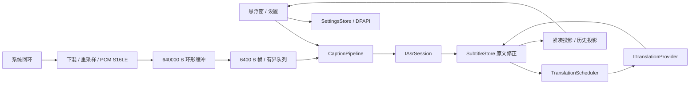

# 模块与技术架构

此实现从第一阶段**可验证的行为规格**独立编写。第一阶段资源摘录和二进制没有进入产品工程。Windows 音频依赖 NAudio 2.3.0；UI 使用 WPF/.NET 9；无浏览器运行时或其他项目依赖。

| 模块 / 文件 | 责任和关键入口 |
|---|---|
| `src/AntiDbt.Core/Contracts.cs` | `IAudioSource`、`IAsrProvider/IAsrSession`、`ITranslationProvider`，音频、字幕、设置契约；无厂商域名、认证或协议 |
| `SubtitleStore.cs` | `BeginSession/ApplySource/ApplyTranslation`；会话隔离、修正、删除、过期结果拒绝、最多默认 2000 条历史 |
| `TranslationScheduler.cs` | `Schedule/CancelSegment/CancelPending/FlushAsync`；固定合并窗口、同片段最新待处理快照、2 并发、128 待处理任务、128 缓存 |
| `CaptionPipeline.cs` | `StartAsync/RunAsync/ReadResultsAsync/StopAsync/DisposeAsync`；采集、发送、读结果、重连和尾部处理 |
| `SubtitleProjection.cs` | `Compact/Expanded`；句边界、两轨段落与草稿状态 |
| `LatencyMonitor.cs` | 最近 1000 次单调时钟观测，median/p95 |
| `src/AntiDbt.Windows/AudioSources.cs` | `WasapiAudioSource`、`StreamingPcmConverter`、`PcmRing`、`WaveFileAudioSource` |
| `SettingsStore.cs` | 原子配置封套、DPAPI、损坏恢复；秘密字段不参与普通设置序列化 |
| `src/AntiDbt.Providers/ProviderCatalog.cs` | 当前适配器选择与默认值；新增厂商只扩展 Provider 层和设置选择，无须改字幕核心 |
| `VolcengineAsrProvider.cs` | 公开二进制 WebSocket 协议、累计 utterance 调和、临时片段删除与本地修订号 |
| `VolcengineMachineTranslationProvider.cs` | 公开 HTTP MT、语言映射、安全错误、响应大小与重定向限制 |
| `src/AntiDbt.Desktop/MainWindow.cs` | 生命周期互斥、原文优先、双模式、虚拟历史、滚动跟随、复制、置顶及窗口位置 |
| `SettingsWindow.cs` | 所有用户 API 配置和 PasswordBox 密钥输入 |

## 音频与时序

WASAPI 采集当前指定输出设备；支持 PCM16/24/32 与 float32，下混为单声道，连续 area/box 重采样到 16 kHz S16LE。转换保留部分输入帧和采样相位。它不是高阶带限重采样器，真实语音质量仍需要评估。

640000 B 环形缓冲名义 20 秒，完整块 6400 B 名义 200 ms。Windows 输出 channel 和管线发送 FIFO 各最多 50 块，均丢最旧；合计可能存在约 20 秒队列容量，加上环形容量，不代表通常延迟或保证可重放时长。实际 Feed 会即时排出完整块，环形主要吸收回调大小差异。丢样推进音频时间轴；管线显示其发送 FIFO 的丢弃计数，Windows channel 的丢弃数暂不显示。

纯零 PCM 连续超过 7 秒后停止常规入队；这不是语音活动识别 VAD，不把低音量声音当作静音。发送侧无数据超过 2 秒补一个 200 ms 零帧，减少网络服务的音频超时风险。这是独立工程策略，尚未由真实火山服务验证。

连接失败后有界缓存继续接收，发送恢复时按照块时长节流。每次成功新连接创建新 generation，保留历史；旧连接的结果与翻译不能进入新 generation。最多 10 次连续失败，发送成功会重置失败计数。失败块可能已被取出而不能重放，不能承诺无损恢复。

正常停止预算为 9 秒，超时取消后最多再等 2 秒；ASR drain 4 秒、翻译 drain 3 秒。当前 Provider 自身 final drain 为 3 秒。队列积压过大时尾部可能在总预算内被截断。Windows 释放另有 10 秒 RecordingStopped 等待，不能声称整个关闭一定 11 秒以内；极端驱动问题可能显示失败或退出时由进程回收。

## 字幕一致性与翻译及时性

每个片段由 session、segment ID、revision 定位。原文立即入状态并触发界面；翻译独立等待。更高修订覆盖原文，删除事件移除被重切分替代的片段，同时取消其待翻译工作。当前 session 有界 tombstone 防止旧修订复活。

固定合并窗口默认 350 ms，持续修订不会不断重置等待。一个片段正在翻译时保留最新待处理快照，完成或失败后继续最新版本。最终片段不额外等待窗口，但已开始的等待最长仍可有剩余窗口。翻译请求 2 并发，使用超时与主动取消；不遵守取消的自定义 Provider 最多允许 16 个未完成调用，之后暂停创建该类调用，避免无限堆积。

`TranslationText` 只对应当前精确修订。旧假设的完成译文可放在单独的 `ProvisionalTranslationText/TranslationRevision`，以“待更新”标记显示；不能覆盖更高修订译文，也不能跨会话。这样持续说话且 MT 慢于 ASR 时仍能显示明确标注的译文草稿。最终译文替换草稿。字幕核心上下文最多取当前会话之前 4 条 final；当前公开 MT 没有上下文字段，适配器不发送该上下文。

## 视图与安全

默认 600 DIP 宽、圆角 12、暗色、原文白色 55% alpha、译文白色、字号 16/20/32（行高设置 24/28/44）。紧凑视图每轨最多两行并跟随长句尾部；与原版的逐像素呈现尚未验证。展开视图使用虚拟 ListBox 与增量更新的段落集合，上滚暂停跟随，底部恢复。只读文本框支持范围选择复制，也可复制整段；修正正在选中的文本时可能重置选择。

UI 的忙状态串行化开始、停止、语言、演示和设置切换。关闭等待当前操作后释放音频；源/目标选择和字号可以持久化。窗口保存位置，重启时限制在主工作区。置顶使用 WPF Topmost，未证明在独占全屏、多屏与各种 DPI 下均符合原版。

新认证 `X-Api-Key`，旧认证 APP ID + Access Token。仅 Provider 层掌握认证头；UI SettingsStore 使用 CurrentUser DPAPI 加密秘密。仅在明确开始后发往公开服务；未读取豆包的用户数据或运行时网络凭据。产品不保存音频。默认仅内存保存字幕，不提供持久导出。生产接口禁止明文和 HTTP 重定向；loopback 测试例外只在适配器中允许。

ASR 累计结果调和假设 ordered/non-overlapping、final prefix；时间水位释放已定稿文本，未定稿 suffix 最多 512。不支持的 finalized boundary overlap 会报安全错误并重试，真实服务是否出现这种形状需样本验证。无法从公开客户端交互推断云端模型内部断句、上下文和翻译实现。
