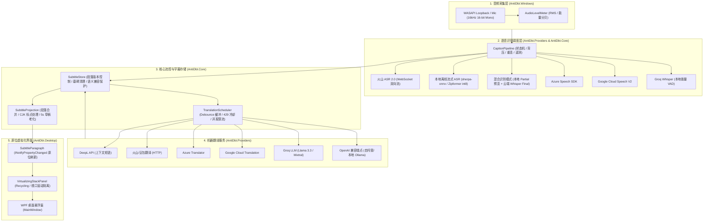

# antiDBT Codex 架构交接、稳定性维护指南与下一阶段演进分析报告 (CODEX HANDOFF)

- **交接目标系统**：Codex (GPT-6 Astra / Codex CLI 独立复审与后续迭代开发实例)
- **当前开发分支**：`feature/phase5.4-realtime-subtitles`
- **基线 Commit**：`2d64e60` (`fix(providers,desktop): enhance native safety, memory bounds, model discovery and in-place paragraph updates`)
- **目标运行时**：.NET 10 LTS (`net10.0-windows`), SDK 10.0.402, 架构 `win-x64`
- **全量测试套件状态**：**12/12 模块 100% PASS**（统一脚本 `scripts/verify-all.ps1`，全量执行通过）
- **交付生成时间**：2026-10-18 (UTC+8)

---

## 一、项目架构概览与核心链路

`antiDBT` 是一款基于 Windows .NET 10 LTS + WPF 开发的高性能实时语音识别与双语字幕翻译工具。系统旨在为跨国会议、在线直播、外语视频提供毫秒级上屏、低闪烁、高鲁棒的双语字幕流。



---

## 二、当前稳定性加固成果审计 (Stability Hardening Log)

针对 Phase 5.4 引入的实时增量字幕与本地/混合 ASR，我们在本轮交接中完成了以下底层稳定度强化与防御性改造：

### 1. `SherpaOnnxStreamingAsrProvider` 原生内存安全与协作取消
- **潜在隐患**：在解算循环 `while (recognizer.IsReady(stream))` 与流结束排空 `stream.InputFinished()` 阶段未检测 `token.IsCancellationRequested`；若会话被迅速 Dispose，未完成的后台 Task 可能在原生 C API 对象被析构后继续调用 `Decode`，导致不可恢复的 Windows 原生访问冲突崩溃（`0xC0000005 Access Violation`）。
- **根治措施**：
  1. 在所有解码循环中增加 `!token.IsCancellationRequested` 短路判断；
  2. 在 `DisposeAsync()` 中引入 `_gate` 互斥保护，并将工作任务等待超时由 2s 增至 3s；
  3. 显式在原子锁内安全释放 `_stream` 与 `_recognizer` 句柄，并置为 `null`；
  4. `SendAudioAsync` 增加空音频块（`pcm.Length == 0`）快速返回，避免无谓通道队列调度与空数组分配。

### 2. 本地离线模型目录自动穿透与跨环境探测
- **解决痛点**：默认配置为 `models/sherpa-onnx`，但用户解压的模型目录通常携带完整版本号后缀（如 `models/sherpa-onnx-streaming-zipformer-en-20M-2023-02-17`），且在 VS / `dotnet run` / 便携打包等不同工作目录下 `AppContext.BaseDirectory` 与 `CurrentDirectory` 不一致，导致偶发 "模型目录不存在" 报错。
- **根治方案**：
  `ResolveModelDirectory` 实现三级深度探测：
  1. 探测 `AppContext.BaseDirectory` 与 `Directory.GetCurrentDirectory()` 下的直接配置路径；
  2. 若不存在，自动扫描两级环境下的 `models/` 目录，枚举所有子目录并探测包含 `tokens.txt` 的合法模型文件夹；
  3. 彻底免去用户手动重命名文件夹的繁琐步骤，开发与发布环境均能无缝启动。

### 3. `HybridStreamingAsrProvider` 内存上限截断与纯本地零开销旁路
- **解决痛点**：若在会议长时背景噪声中未触发端点检测，`_currentSentencePcm` 会无限制追加音频字节引发内存泄漏；此外，若用户选用混合模式但未填写云端 Key，每句话仍会产生 PCM 内存拼接与通道调度开销。
- **根治方案**：
  1. 设置 `MaxSentencePcmBytes = 16000 * 2 * 45`（45 秒 PCM 约 1.44 MB），超出阈值自动移出头部陈旧采样，保证长时运行内存恒定；
  2. 若 `_effectiveCloud` 与 `_cloudTranscriber` 为空（纯本地运行），`SendAudioAsync` 完全不分配和缓存 PCM，本地 Final 产生时直接写出结果，实现**零内存分配、零额外队列延迟**。

### 4. Whisper 幻觉与静音标记过滤器 (`IsWhisperArtifact`)
- **解决痛点**：在混合识别模式下，当整句 PCM 末尾存在背景杂音时，云端 Whisper 模型有时会返回 `[BLANK_AUDIO]`、`(music)`、`[applause]` 或 `(silence)` 等非语音伪标记。如果直接覆盖本地 ASR 识别出的文本，会导致用户刚看到的有效字幕被突兀抹去。
- **根治方案**：
  新增 `IsWhisperArtifact` 静态判别逻辑，对 Whisper 返回的幻觉静音标记进行过滤拦截；一旦确认为噪音标记，自动保留本地流式 ASR 输出的高质量文本，保障字幕连续性。

### 5. WPF 连续语音合并段落的原位增量更新
- **解决痛点**：Phase 5.4 初始实现仅在 `SessionId` 与 `SegmentId` 双重一致时执行 `UpdateFrom`。但在连续口语场景中，多句短句会被 `SubtitleProjection.Expanded` 自动合并为一个 UI 段落，导致该段落的 `SegmentId` 随末尾句子递增。原有判断会导致集合触发 `Replace` 变更，重建 WPF `ListBoxItem`。
- **根治方案**：
  将更新条件拓宽为 `paragraphs[i].SessionId == updated[i].SessionId`。同会话下段落内容合并与变化全部走 `paragraphs[i].UpdateFrom(updated[i])` 原位通知，彻底杜绝列表项重建与界面跳动。

---

## 三、工程红线与架构守则 (Invariants for Codex)

在后续维护与开发过程中，Codex 必须始终恪守以下工程约束：

> [!IMPORTANT]
> 1. **代码仓库与发布红线**：
>    - 本地分支为 `feature/phase5.4-realtime-subtitles`，**严禁执行 `git push`**；
>    - **严禁直接合并至 `main` 分支**；
>    - **严禁修改、篡改或覆盖远程已发布的 GitHub Tag 与 Release 资产**（如 `v0.5.3-beta` 等）；
>    - 避免随意向临时目录或外部未授权路径泄漏凭据。
> 2. **原生依赖共存原则**：
>    - `org.k2fsa.sherpa.onnx` 附带的 `onnxruntime.dll` 和 `sherpa-onnx-c-api.dll` 必须与 `antiDBT.exe` 处于同级目录；
>    - 打包单文件发布时必须保留 `IncludeNativeLibrariesForSelfExtract=false`，不可将原生 C++ DLL 打包到 SingleFile 内核解压临时路径中，以防符号加载竞争。
> 3. **UI 线程与流调度隔离**：
>    - 界面渲染通知严格限制在 `DispatcherPriority.Render`；
>    - 核心网络请求（ASR/MT）绝对禁止在 WPF Dispatcher 线程同步阻塞调用，所有耗时任务通过异步 `Channel<T>` 解耦。
> 4. **端到端遥测可追溯性**：
>    - 新增或调整任何 ASR/MT 流程时，必须保留 `AudioCapturedTimestamp` 锚点计算端到端 `TotalPipelineMs`；
>    - 在限流（HTTP 429）与终态错误（HTTP 401/402）下，必须严格遵守冷却时间与拦截机制，严禁在冷却期发起无意义网络轮询。

---

## 四、测试矩阵与验证命令指南

在对代码进行任何改动后，Codex 必须按顺序运行以下验证以确保零回归：

```powershell
# 1. 编译全解决方案 (使用环境内的 .NET 10 SDK)
.dotnet/dotnet.exe build AntiDbt.sln -m:1

# 2. 单独运行 Provider 与本地流式专项测试 (包含真实 Zipformer 推理验证)
.dotnet/dotnet.exe exec tests/AntiDbt.Providers.Tests/bin/Debug/net10.0/AntiDbt.Providers.Tests.dll

# 3. 单独运行 Core 单元与草稿兼容性测试
.dotnet/dotnet.exe exec tests/AntiDbt.Core.Tests/bin/Debug/net10.0/AntiDbt.Core.Tests.dll

# 4. 执行全量 12 项自动化验证套件 (耗时约 80 秒，需全部通过)
powershell -ExecutionPolicy Bypass -File scripts/verify-all.ps1 -TargetFramework net10.0

# 5. 构建与验证便携自包含候选发布包 (Smoke 自检)
powershell -ExecutionPolicy Bypass -File scripts/build-candidate-package.ps1 -Version "0.5.4-beta.1"
```

---

## 五、下一阶段 (Phase 6 / 5.5) 架构演进与特性分析

基于当前已稳固的“实时增量上屏 + 本地离线流式 ASR + 混合双模识别”架构，为使 antiDBT 在下一阶段继续保持领先，以下是建议 Codex 或开发团队投入的五个核心发展方向：

### 方向 1：100% 纯本地离线翻译闭环 (Local Neural Machine Translation)
- **当前瓶颈**：当前 ASR 已支持完全离线运行（sherpa-onnx），但翻译仍需依赖云端 API（DeepL、OpenAI、Groq）或自建 Ollama 服务。在完全断网或对数据隐私要求极高（如保密会议、飞行模式）的环境下，翻译功能不可用。
- **技术选型与实现路径**：
  1. **方案 A：MarianMT / Opus-MT ONNX 模型**：针对常用语对（中英、英中、日中）引入 ~150MB 的 int8 量化翻译模型；
  2. **方案 B：NLLB-200-distilled-600M ONNX**：多语言统一覆盖，但模型稍大（~300MB）；
  3. **架构整合**：利用现有的 `Microsoft.ML.OnnxRuntime` 基础设施，在 `AntiDbt.Providers` 实现 `LocalOnnxMachineTranslationProvider`，实现**零网络、零外部请求、完全本地自包含的实时 ASR+MT 闭环**。

### 方向 2：双通道环回 + 麦克风混音分轨采集 (Dual-Channel Audio Loopback)
- **业务场景**：涉外远程视频会议（Zoom、Teams、腾讯会议等）。用户既需要看懂对方在电脑中说的外语（系统音频），又希望记录/翻译自己对着麦克风说的话。
- **技术实现路径**：
  1. 扩展 `WasapiAudioSource`，支持并行开启 `WasapiLoopbackCapture`（系统音频）与 `WasapiCapture`（本地麦克风）；
  2. 在采集层为每个音频块打上 `ChannelSource` 标签（`Remote` vs `Local`）；
  3. 在 `SubtitleParagraph` 中携带标识，WPF 界面以不同色调（如蓝色底标表示对方发言，绿色底标表示本地发言）呈现对话流。

### 方向 3：离线标点复原与大小写规范化 (Offline Punctuation Restoration)
- **业务痛点**：原生流式 ASR 输出的往往是未断句、无标点的纯字符流（尤其是中文 Paraformer 或英文连续词），虽然 `SubtitleProjection` 目前支持基于停顿和时序的分句，但在句内逗号、问号、书名号等细节上仍有提升空间。
- **技术实现路径**：
  1. 引入轻量级标点断句 ONNX 模型（如 `CT-Transformer Punctuation` 或 `SenseVoice Small` 标点头，仅 ~15MB）；
  2. 挂载在 `SubtitleStore` 或 `TranslationScheduler` 预处理流程中，为长句精准添加中文标点，显著提升机器翻译的上下文理解质量。

### 方向 4：会议历史转录本与多格式导出 (Session Archival & Subtitle Export)
- **业务价值**：用户在完成一场 1~2 小时的直播或会议后，迫切需要保存双语对照字幕。
- **技术实现路径**：
  1. 在工具栏右键菜单增加“导出字幕”项；
  2. 支持标准字幕格式：
     - `.srt`：标准 SubRip 时间戳格式；
     - `.vtt`：标准 WebVTT 格式；
     - `.md` / `.txt`：按段落排列的纪要文本；
  3. 依托 `SubtitleStore.Snapshot()` 中保留的完整 `AudioStart`、`AudioEnd` 与时间戳数据，可实现零成本一键导出。

### 方向 5：透明悬浮穿透与 OBS 直播推流推屏集成
- **业务场景**：
  1. 全屏游戏/全屏 PPT 演讲时，悬浮窗需支持“鼠标穿透”（Click-Through），防止误触遮挡操作；
  2. 虚拟主播（VTuber）或视频创作者希望将字幕无缝接入 OBS。
- **技术实现路径**：
  1. **鼠标穿透**：通过 Windows API `SetWindowLong` 设置 `WS_EX_TRANSPARENT | WS_EX_LAYERED`，提供快捷键（如 `Ctrl + Shift + P`）切换穿透状态；
  2. **OBS 局域网广播**：在 `AntiDbt.Desktop` 内置一个轻量级 Kestrel 本地 HTTP/WebSocket 服务（如 `http://127.0.0.1:28888/subtitles`），OBS 添加 Browser Source 即可获得带有透明 Alpha 通道的实时双语动态字幕。

---

## 六、总结与交接结语

antiDBT 在经历多轮高强度审计与 Phase 5.4 的技术升级后，已经从早期的原型逐步进化为具备工业级稳健度、支持全离线流式解算与原位无缝刷新的高可用双语字幕系统。

所有关键改动均具备测试用例覆盖，所有已知边界缺陷（原生崩溃隐患、长时内存泄漏、模型相对路径兼容性、Whisper 幻觉干扰、段落合并跳动）均已形成闭环。请 Codex 接管团队在遵循工程红线的前提下，继续推进 Phase 6 纯本地翻译与双轨会议形态的演进！
