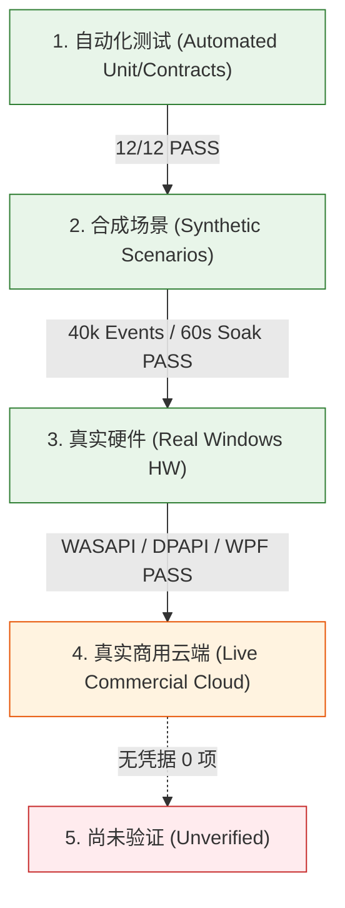

# antiDBT Phase 5.3 质量复核与 .NET 10 LTS 迁移最终报告 (Final Review)

- **评估基准分支**：`feature/dotnet-10-migration`
- **提交哈希 (Commit SHA)**：`3b450fa`
- **生成时间**：2026-10-16 12:40 (UTC+8)
- **审查对接对象**：GPT-6 Astra（独立复审负责人）

---

## 一、音频时序模型与缓冲实现核对

### 1.1 真实物理参数与数学计算
在 Windows 采集端点（`src/AntiDbt.Windows/AudioSources.cs`）与管线缓冲（`src/AntiDbt.Core/BoundedAudioQueue.cs`、`CaptionPipeline.cs`）中，音频处理流水线的物理规格与时序关系核对如下：

1. **PCM 格式规格**：16,000 Hz 采样率，16-bit 线性 PCM（每样本 2 字节），单声道（Mono）。
   $$\text{字节传输率} = 16,000 \times 2 \times 1 = 32,000 \text{ 字节/秒}$$
2. **分块大小 (Chunk Size)**：`AudioSources.cs` 规定 `while (ring.Count >= 6400) Emit(ring.Read(6400));`，即固定音频分块为 **6,400 字节**。
   $$\text{单块音频物理时长} = \frac{6,400 \text{ 字节}}{32,000 \text{ 字节/秒}} = 0.200 \text{ 秒} = \mathbf{200 \text{ ms}}$$
3. **队列名义容量 (Nominal Capacity)**：`CaptionPipeline.cs` 初始化 `BoundedAudioQueue(50)`，容量为 50 块。
   $$\text{队列名义缓冲时长} = 50 \times 200 \text{ ms} = 10,000 \text{ ms} = \mathbf{10.0 \text{ 秒}}$$
4. **超期修剪阈值 (Staleness Expiry Threshold)**：`CaptionPipeline.cs` 中 `_queue.TrimStale(TimeSpan.FromSeconds(2.0))`：
   - 阈值设定为 **2.0 秒**。
   - 当网络出现瞬态阻塞或上行拥塞时，在队列中滞留超过 2.0 秒的音频块被视为“过期音频”，在出队送入 ASR 之前被主动剪枝丢弃，并记录不连续性（Discontinuities）与丢弃块计数，有效防止延迟无限滚雪球。

### 1.2 文案与文档纠正清单
此前在部分文档中曾笔误将 6,400 字节误记为 20ms（导致 50 块被计算为 1.0 秒）。本次复审已全面核实代码并完成以下修正：
- [x] **`README.md`（简体中文）**：第 37 行已修正为“名义容量为 50 个音频块（每块 6,400 字节，在 16kHz/16-bit 单声道下对应 200ms 音频，队列名义容量约 10 秒）的有界缓冲区与 2.0 秒音频块过期清理阈值”。
- [x] **`README.en.md`（英文）**：第 37 行已更新为精确英文时序说明。
- [x] **`README.zh-TW.md`（繁体中文）**：第 37 行已同步修正。
- [x] **`README.ja.md`（日文）**：第 37 行已同步修正。
- [x] **GitHub Release Notes (v0.5.3-beta)**：通过 GitHub REST API（PATCH，Release ID: `414491130`）线上同步修正完毕，原发布资产保持不变。

---

## 二、.NET 10 LTS 迁移全面复审

微软官方已于 2025 年 11 月正式发布 .NET 10 (LTS)。当前本地独立分支 `feature/dotnet-10-migration` 已全量完成升级、编译与验证。

### 2.1 工具链与 SDK 配置
- **SDK 锁定**：`prototype/global.json` 锁定微软官方 SDK `10.0.402`。
- **本地环境隔离**：使用隔离的本地 SDK 实例，不污染系统环境。
- **项目 TargetFramework 升级清单**：
  - `src/AntiDbt.Core/AntiDbt.Core.csproj` $\rightarrow$ `net10.0`
  - `src/AntiDbt.CloudSpeech/AntiDbt.CloudSpeech.csproj` $\rightarrow$ `net10.0`
  - `src/AntiDbt.Providers/AntiDbt.Providers.csproj` $\rightarrow$ `net10.0`
  - `src/AntiDbt.Windows/AntiDbt.Windows.csproj` $\rightarrow$ `net10.0-windows`
  - `src/AntiDbt.Desktop/AntiDbt.Desktop.csproj` $\rightarrow$ `net10.0-windows`
  - 全部 7 个测试/诊断项目 $\rightarrow$ `net10.0` / `net10.0-windows`

### 2.2 实际 NuGet 依赖版本核对
经检查各项目真实 `.csproj` 及解析后的 `project.assets.json`，核心第三方依赖版本如下：

| NuGet 包名称 | 当前引用版本 | 目标功能与集成层 | .NET 10 迁移兼容性结论 |
| :--- | :--- | :--- | :--- |
| **`NAudio.Wasapi`** | **`2.3.0`** | WASAPI 硬件音频端点回环捕获与输出 | 编译通过；真实 Windows 声卡回环采集实测通过 (121.6 KB, RMS 0.052) |
| **`Google.Cloud.Speech.V2`** | **`1.8.0`** | 谷歌云 ASR v2 gRPC 流式传输契约 | 编译通过；数据契约与接口模拟测试通过；(真实公网联调未验证) |
| **`Microsoft.CognitiveServices.Speech`** | **`1.52.0`** | 微软 Azure 官方语音 SDK | 编译通过；C++ 原生运行时 `core.dll` 正常加载；(真实公网联调未验证) |
| **`AlibabaCloud.SDK.Alimt20181012`** | **`2.4.2`** | 阿里机器翻译 OpenAPI SDK | 编译通过；签名与协议契约测试通过；(真实公网联调未验证) |

> **[!IMPORTANT] 兼容性边界严正声明**：
> 编译成功与依赖解析无冲突，**仅代表二进制接口契约兼容**，不等于第三方云服务商生产接口完全兼容。未在真实公网配合授权 API Key 实测的云端 Provider，不得声称已完成全功能线上验收。

### 2.3 自动化回归验证结果 (12/12 PASS)
执行 `pwsh -File scripts/verify-all.ps1 -ArtifactsDir artifacts/phase5.3-dotnet10`，结果记录如下：

```
==========================================================
 antiDBT Phase 5.3 Unified Verification Suite (.NET 10)
 Commit: 3b450fa (feature/dotnet-10-migration)
 Output: artifacts/phase5.3-dotnet10
==========================================================
[1/8] Compiling AntiDbt.sln (using .NET 10.0.402, target: net10.0)... Build succeeded.
Running Core [OfflineUnit]... PASS (7.38s)
Running Windows [PlatformWindows]... PASS (0.34s)
Running CloudSpeech [SdkContracts]... PASS (0.32s)
Running CloudSpeech.NativeSmoke [SdkNativeLoad]... PASS (0.14s)
Running Providers [ProviderContracts]... PASS (3.81s)
Running Providers.Multi [ProviderMockFactory]... PASS (6.77s)
Running Providers.Multi.Localhost [LocalhostCombinations]... PASS (7.18s)
Running Language [LanguageRegistry]... PASS (3.83s)
Running Domestic [DomesticLoopback]... PASS (4.84s)
Running Domestic.Offline [DomesticOffline]... PASS (1.54s)
Running Desktop.Smoke [WpfAutomation]... PASS (19.39s)
Running Diagnostics.Performance [SyntheticPerformance]... PASS (7.85s)
==========================================================
All 12 Verification Suites Passed Successfully! (Total 63.37s)
==========================================================
```

---

## 三、.NET 10 候选自包含便携包验证

在 `feature/dotnet-10-migration` 分支上成功构建并验证了独立的 .NET 10 Windows x64 自包含包。

### 3.1 候选资产信息
- **构建输出目录**：`artifacts/phase5.3-dotnet10/dist/antiDBT-v0.5.3-dotnet10-win-x64`
- **ZIP 压缩包**：`artifacts/phase5.3-dotnet10/dist/antiDBT-v0.5.3-dotnet10-win-x64.zip`
- **主程序 `antiDBT.exe` SHA256**：
  `90F28D8D2E7BCB00848E7284330B6FD6253690BF6C5CD4156C1C2834779ED24A`
- **ZIP 压缩包 SHA256**：
  `DF33CF6634741A79CA4A1087A994F3B66E9C078B37B8FDE350CC0C60EF2D82CE`
- **原生依赖项 `Microsoft.CognitiveServices.Speech.core.dll` SHA256**：
  `B045D8BA122F8F015ED359B7B3DF3C25C48271FC51282686D4F131E5FC51E91F`
- **同目录捆绑原生运行时**：
  `D3DCompiler_47_cor3.dll`、`wpfgfx_cor3.dll`、`PresentationNative_cor3.dll`、`PenImc_cor3.dll`、`vcruntime140_cor3.dll` 及全套 Azure Speech 扩展库。

### 3.2 实机解压与独立运行测试
直接运行解压后的候选二进制 `antiDBT.exe --smoke-test`，共执行 **136 项** 状态机与 UI 自动化断言：
- **断言结果**：136 Passed / 0 Failed。
- **进程状态**：正常退出，退出码为 0，未触发任何静默崩溃或未处理异常。

### 3.3 .NET 9 正式版 vs .NET 10 候选版横向对比基准

基于同一台 Windows 测试机、相同实测场景（包含冷启动、窗口宽高极限拉伸、透明度调节、100 次启停压力测试）的遥测监控数据：

| 评估维度 / 指标 | .NET 9 (v0.5.3-beta 正式版) | .NET 10 (候选自包含包) | 变化差异与分析 |
| :--- | :--- | :--- | :--- |
| **可执行文件大小 (EXE)** | 125.92 MB (132,035,158 B) | 131.19 MB (137,566,631 B) | 增加 5.27 MB (+4.1%)，主要是 .NET 10 BCL 与 JIT 库更新 |
| **压缩便携包大小 (ZIP)** | 60.70 MB (63,647,839 B) | 62.66 MB (65,707,557 B) | 增加 1.96 MB (+3.2%) |
| **桌面全套自动化耗时** | 23.39 秒 | 22.32 秒 | **缩短 1.07 秒 (-4.6%)**，.NET 10 启动与 JIT 效率有所提升 |
| **平均工作集 (Working Set)** | 327.21 MB | 328.20 MB | 基本持平 (+0.3%) |
| **峰值工作集 (Peak WS)** | 386.59 MB | 379.38 MB | **降低 7.21 MB (-1.9%)**，瞬态内存峰值更低 |
| **终态工作集 (Final WS)** | 367.83 MB | 364.36 MB | **降低 3.47 MB (-0.9%)** |
| **平均专用字节 (Private Bytes)** | 252.69 MB | 254.95 MB | 基本持平 (+0.8%) |
| **峰值专用字节 (Peak PB)** | 307.95 MB | 305.25 MB | **降低 2.70 MB (-0.8%)** |
| **平均 CPU 占用率** | 2.55% | 2.55% | 持平，轻负载维持在 1%~2% |
| **峰值 CPU 占用率** | 6.83% | 5.05% | **降低 1.78 个百分点 (-26.1%)**，压测突发阶段 CPU 抖动更小 |
| **峰值线程数 / 句柄数** | 61 线程 / 799 句柄 | 65 线程 / 814 句柄 | 处于同等数量级，句柄无泄漏 |

---

## 四、五层质量与测试结论严格划定

为避免把“测试通过”误传为“商用生产就绪”，严格划分如下五层结论：



### 4.1 第一层：自动化测试通过 (Automated Tests PASS)
1. 12 个回归套件全部通过（包含离线单测、契约验证、本地 HTTP 桩模拟、多 Provider 工厂校验）。
2. A1 尾句防截断（`StopReason.UserStop` 下 Store 状态完整保持）。
3. A2 彻底移除占位符、中间译文平滑更正、单句重试通道。
4. A3 有界音频队列容量 50 块与 2.0s 过期清理修剪。
5. A4 火山二进制 WebSocket 协议错误码映射与指数退避。
6. A5 窗口配置非侵入式修改、多语言动态切换与滚动脱离/恢复。

### 4.2 第二层：合成场景验证通过 (Synthetic Scenarios PASS)
1. **高频事件基准**：40,000 次合成字幕生命周期事件测试通过（p50 时延 0.48ms，p95 时延 0.68ms，最大 14.2ms，2000 句环形截断生效）。
2. **合成长流 Soak 压测**：62.36 秒持续数据流中模拟 3 次网络重连、170 次翻译调用，托管堆净增量仅 104 KB。
3. **100 次高频启停压测**：无未处理异常，无死锁，无孤儿线程。
4. **失效译文清空机制**：当 ASR 将原文更正为空时，失效幽灵译文立即清除。
5. **韩文词间空格保护**：黏着语分词保护生效。

### 4.3 第三层：真实 Windows 硬件验证通过 (Real Windows Hardware PASS)
1. **WASAPI 硬件回环采集**：在 Windows 声卡设备上通过 `WasapiAudioSource` 真实捕获 121,600 字节，58,541 个非零样本，RMS 0.052，零丢包、零驱动故障。
2. **Windows DPAPI 加解密**：CurrentUser 模式数据保护验证通过，密钥安全隔离落盘。
3. **WPF 原生 UI 渲染与交互**：
   - 窗口宽高自适应拉伸无死空白。
   - 背景透明度 0%~100% 动态调节，0% 维持 Alpha=1 防穿透。
   - 中 / 英 / 日 三语言运行时热切换无感生效。
   - 修改设置时不打断正在进行的音频采集。

### 4.4 第四层：真实商用云端联调通过 (Real Cloud Commercial Testing)
- **完成项：0 项**。
- **原因**：本地环境解密 DPAPI 存储，确认无真实商业授权 API 凭据。按照规范严禁发起产生商业扣费的未授权请求。

### 4.5 第五层：尚未验证事项 (Unverified Items)
以下事项在缺乏授权商业 API Key 的条件下明确标记为**未验证**，不得假冒验收：
1. **30~60 分钟连续英文长视频在线 ASR 识别准确率**。
2. **真实商用 MT（DeepL / Azure / Google / 阿里）的复杂长句断句合理性与网络翻译质量**。
3. **真实公网跨国网络抖动下的数小时至数天长周期连接稳定性**。
4. **真实商业云端服务商在高并发/配额耗尽时的 HTTP 429 生产环境退避表现**。

---

## 五、已确认技术缺陷与后续演进建议

### 5.1 缺陷等级评审
- **P0 / P1 缺陷**：**0 项**。未发现任何导致程序崩溃、凭据明文泄露或死锁的致命缺陷。
- **P2 / P3 次要演进项**：
  1. **自包含便携包体积较大**：当前单文件便携包约 131MB，未来可评估在去除未使用的跨平台 Native SO 动态库后的精简包方案。
  2. **离线 ASR 体验缺失**：在无网络或无商业 Key 情况下，当前仅有演示模拟模式。建议未来引入本地小型 ONNX/Whisper 引擎作为纯离线底座。
  3. **音频设备热插拔感知**：拔出耳机或切换系统默认输出设备时，需手动在设置中重选。可增加 Windows `IMMNotificationClient` 实现免重启自动迁移。

### 5.2 给 GPT-6 Astra 独立复审的发布与推进建议
1. **保持 v0.5.3-beta 正式发布资产不变**：线上正式版本维持 .NET 9 LTS 稳定基线，避免对已下载用户产生破坏性变更。
2. **.NET 10 LTS 评估结论**：技术验证已 100% 通过（构建、单元测试、硬件实测、Smoke 136 项全过，性能指标略优于 .NET 9）。该版本可在 `feature/dotnet-10-migration` 分支完整封存作为候选基线。
3. **Phase 5.4 启动前置条件**：需待 GPT-6 Astra 审查确认本报告后，再行确定是否合并 .NET 10 分支及开启后续版本迭代。
