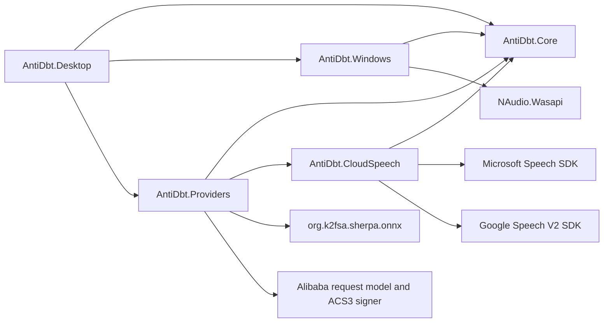
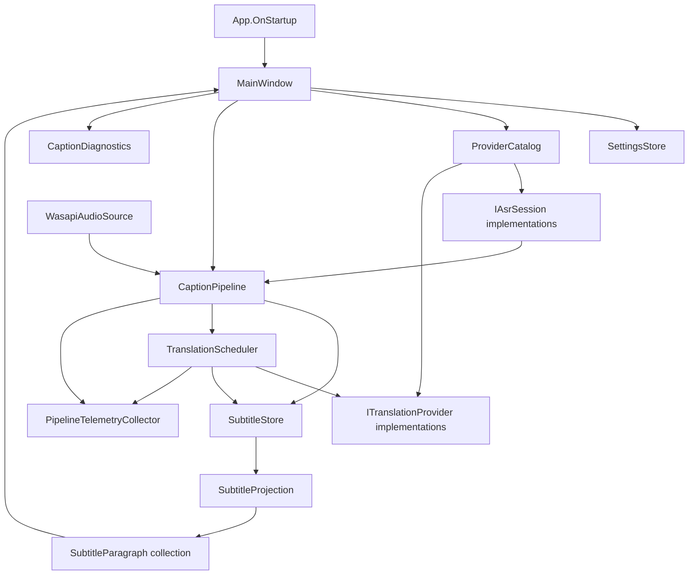
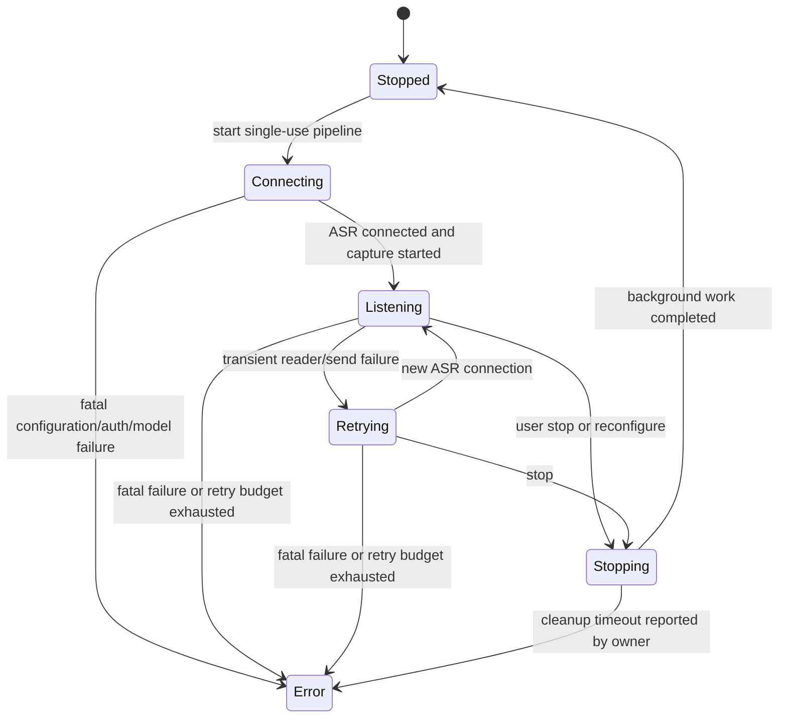
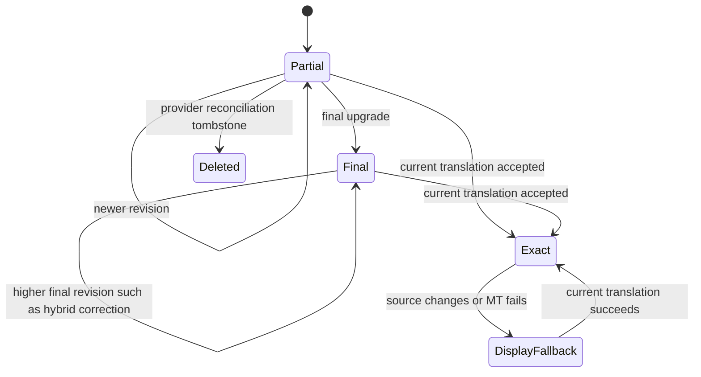

# Architecture

Baseline: `765caa5`, 2026-10-19. All named runtime components below exist in source. Arrows describe calls/data flow, not new architectural layers.

## System and project dependencies



The Desktop constructs concrete dependencies; Core consumes `IAudioSource`, `IAsrProvider`/`IAsrSession`, and `ITranslationProvider` ([Contracts.cs:22](../../../src/AntiDbt.Core/Contracts.cs#L22)). There is no DI container, database, web backend, plugin loader, or independent scheduler service in this checkout. Providers own service-specific transport and language mapping.



Evidence: [App.xaml.cs:7](../../../src/AntiDbt.Desktop/App.xaml.cs#L7), [MainWindow.cs:732](../../../src/AntiDbt.Desktop/MainWindow.cs#L732), [CaptionPipeline.cs:36](../../../src/AntiDbt.Core/CaptionPipeline.cs#L36). Telemetry arrows deliberately do not claim a UI-applied segment measurement; see AQ-06 in the [register](CODE-QUALITY-AUDIT.md).

## Startup and ownership

1. WPF-generated startup invokes `App.OnStartup`. Command-line smoke switches select `MainWindow(testMode: true)` and explicit application shutdown; ordinary startup shows the window. Only non-smoke startup with `ANTIDBT_CAPTION_TRACE=1` enables a diagnostics file ([App.xaml.cs:7](../../../src/AntiDbt.Desktop/App.xaml.cs#L7)).
2. `MainWindow` creates its `SubtitleStore`, settings store rooted at `AppContext.BaseDirectory/data`, WPF controls, event handlers and one-second status timer. `Loaded` calls `InitializeAsync` ([MainWindow.cs:22](../../../src/AntiDbt.Desktop/MainWindow.cs#L22), [MainWindow.cs:414](../../../src/AntiDbt.Desktop/MainWindow.cs#L414)).
3. Settings load decrypts a schema v1/v2 envelope; malformed/decryption failures return defaults with a warning. `LanguageSettings.Upgrade` normalizes identities and display defaults. Test mode bypasses loading/saving personal settings ([SettingsStore.cs:29](../../../src/AntiDbt.Windows/SettingsStore.cs#L29), [MainWindow.cs:431](../../../src/AntiDbt.Desktop/MainWindow.cs#L431)).
4. Start validates provider/language settings. `StartConfiguredPipelineAsync` constructs WASAPI, ASR and MT objects, with the same store retained across pipeline instances. Failed cleanup blocks replacement rather than starting a second capture ([MainWindow.cs:650](../../../src/AntiDbt.Desktop/MainWindow.cs#L650)).
5. `CaptionPipeline.StartAsync` starts `RunAsync` and returns immediately; connection/readiness/failure are asynchronous status/completion concerns. ASR connect has a 12-second cooperative deadline. Audio capture starts only after recognition readiness ([CaptionPipeline.cs:45](../../../src/AntiDbt.Core/CaptionPipeline.cs#L45), [CaptionPipeline.cs:98](../../../src/AntiDbt.Core/CaptionPipeline.cs#L98)). Synchronous native initialization can exceed that deadline if it does not yield.

| Owner | Owned work/resources | Lifetime boundary |
|---|---|---|
| MainWindow | Store, paragraphs, timer, current pipeline; HWND hook/hotkey | Window close; settings change may replace pipeline |
| CaptionPipeline | Audio source, scheduler, capture task, connection attempts, audio queue | Single-use pipeline; stop/dispose gates serialize cleanup |
| ASR session | Socket/SDK/native stream and provider channels/workers | One recognition connection; retry creates another session |
| TranslationScheduler | Jobs, attempts, logical slots, cache, telemetry references | Pipeline lifetime; contextual task exception noted in AQ-02 |
| SettingsWindow | Local profile copies, reveal views, explicit provider probe cancellation | Dialog close cancels probes and clears visible secrets |

## Complete runtime data flow

```mermaid
flowchart LR
    WASAPI[LoopbackSession.Data] --> Convert[StreamingPcmConverter.Convert]
    Convert --> PCM[PcmAudioSource.Feed and PcmRing]
    PCM --> Capture[CaptionPipeline.CaptureAsync]
    Capture --> Queue[BoundedAudioQueue]
    Queue --> Send[IAsrSession.SendAudioAsync]
    Send --> Local[Sherpa ProcessLoopAsync]
    Send --> Cloud[Cloud provider recognition]
    Local --> Segment[StreamingSentenceManager.Observe]
    Segment --> Results[AsrResult Partial Final or batch]
    Cloud --> Results
    Results --> Read[CaptionPipeline.ReadResultsAsync]
    Read --> Store[SubtitleStore.ApplySource or ApplySources]
    Read --> Schedule[TranslationScheduler.Schedule]
    Schedule --> Window[ProcessAsync context and lookahead selection]
    Window --> MT[ITranslationProvider.TranslateAsync]
    MT --> Revision[ApplyTranslation or provisional fallback]
    Revision --> Store
    Store --> Event[Changed event]
    Event --> Render[MainWindow.QueueRender and Render]
    Render --> Project[SubtitleProjection.Expanded]
    Project --> WPF[SubtitleParagraph bindings in ListBox]
```



Sentence segmentation in this diagram is the local Sherpa policy. Volcengine reconciles provider utterance snapshots; Azure/Google map SDK results; Groq segments PCM using its own energy chunker. There is no universal local sentence manager inserted after every cloud ASR.

## Critical asynchronous sequence

```mermaid
sequenceDiagram
    participant UI as MainWindow
    participant P as CaptionPipeline
    participant A as IAsrSession
    participant S as SubtitleStore
    participant T as TranslationScheduler
    participant M as ITranslationProvider
    UI->>P: StartAsync
    P->>A: ConnectAsync
    P->>P: Start audio and CaptureAsync
    par capture and send
        P->>P: enqueue bounded PCM chunks
        P->>A: SendAudioAsync
    and recognition reader
        A-->>P: Partial or atomic Final plus next Partial
        P->>S: ApplySource / ApplySources
        P->>T: Schedule accepted revision
    end
    S-->>UI: Changed; dispatcher coalesces Render
    T->>T: debounce / semantic wait / acquire logical slot
    T->>M: TranslateAsync with previous context and lookahead
    M-->>T: text or typed failure
    T->>S: exact session/revision update or compatible provisional
    S-->>UI: Changed; update existing paragraph objects
    UI->>P: StopAsync(UserStop)
    P->>P: stop capture and drain queued audio
    P->>A: CompleteAsync; bounded final-result drain
    P->>T: bounded FlushAsync then cancel remaining work
    UI->>P: DisposeAsync
```

The normal path above is guarded. Contextual retranslations use separate tasks; they must not be assumed to inherit the normal request's cancellation, cooldown, cache or revision commit behavior ([TranslationScheduler.cs:123](../../../src/AntiDbt.Core/TranslationScheduler.cs#L123)).

## State and concurrency boundaries



`PipelineState` is published status, not a central transition-enforcement class. A fresh pipeline is required for a subsequent start. Retries retain history while advancing store generation. ASR retry budget is ten failures, reset only after a result and five healthy seconds; exponential delay starts at 500 ms and caps at five seconds, with explicit handling of `RetryAfter` ([CaptionPipeline.cs:153](../../../src/AntiDbt.Core/CaptionPipeline.cs#L153), [CaptionPipeline.cs:210](../../../src/AntiDbt.Core/CaptionPipeline.cs#L210)).



Source finality and translation completion are independent fields, not mutually exclusive runtime states. The diagram summarizes transitions across those fields. Final-to-Partial and deletion of confirmed Finals are rejected; display fallback never proves exact translation completion ([SubtitleStore.cs:120](../../../src/AntiDbt.Core/SubtitleStore.cs#L120)).

| Boundary | Synchronization / backpressure | Important limit |
|---|---|---|
| Capture callback → PCM channel | Source lock; bounded channel dropping oldest | 50 chunks; drops here are not pipeline queue counters |
| Capture task → send loop | Locked BoundedAudioQueue; polling and pacing | 50 chunks; stale age 2 s during listening |
| ASR workers → results reader | Provider channels/SDK callbacks | Usually 256 results; provider-specific overflow policy |
| Source/translation → store | Internal store monitor; notify after ordinary commit | Max history default 2000, clamp 1–10000 |
| MT jobs | Scheduler monitor, two logical slots, Final priority | 128 jobs/cache entries; 16 outstanding normal requests |
| Store → WPF | Coalesced dispatcher operation at Render priority | No fixed FPS throttle; Loaded-priority follow scrolling |

## Stop, cancellation and exception semantics

User stop allows tail capture/ASR/MT drain; reconfigure/shutdown cancel more aggressively. `StopAsync` uses a 10-second user deadline plus a two-second cancellation wait, or a two-second quick-stop deadline. `RunAsync` additionally budgets four seconds for ASR completion/reader drain and three seconds for MT flush. These budgets are cooperative and overlap; they are not guarantees against a blocking native call ([CaptionPipeline.cs:169](../../../src/AntiDbt.Core/CaptionPipeline.cs#L169), [CaptionPipeline.cs:434](../../../src/AntiDbt.Core/CaptionPipeline.cs#L434)).

`DisposeAsync` retains failure if background completion remains active and permits cleanup retries. `MainWindow.CloseAsync` stops its monitor, waits for an action, attempts shutdown, saves position, unregisters the hotkey and closes even after an exception ([MainWindow.cs:1198](../../../src/AntiDbt.Desktop/MainWindow.cs#L1198)). Some provider cleanup methods swallow bounded-wait failures and then free resources; see the native lifetime risk register. Anonymous pipeline callbacks are not explicitly unsubscribed, but ordinary closed ownership cycles are collectible; retained late workers can extend window lifetime. No deterministic deadlock is claimed from that fact alone.
