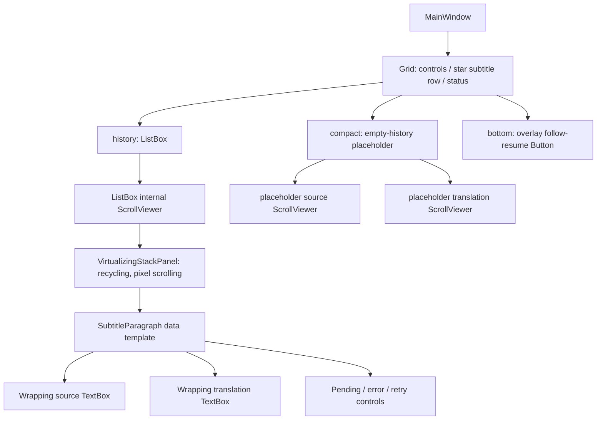
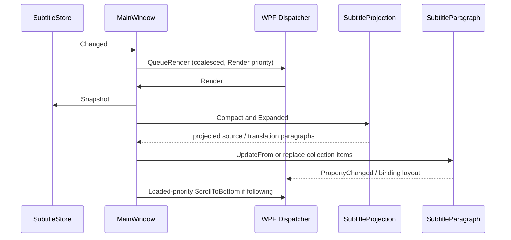

# UI Architecture

Baseline: [Project Overview](PROJECT-OVERVIEW.md). The application uses programmatically built WPF controls; `App.xaml` supplies resources, not a declarative main-window layout.

## Windows, composition and lifecycle

| Component | Responsibility | Evidence |
|---|---|---|
| `App` | WPF startup; normal and smoke-mode dispatch; opt-in caption tracing | [App.xaml.cs:10](../../../src/AntiDbt.Desktop/App.xaml.cs#L10) |
| `MainWindow` | Composition root, capture actions, settings application, language changes, subtitle projection, follow state, export and native window interaction | [MainWindow.cs:118](../../../src/AntiDbt.Desktop/MainWindow.cs#L118) |
| `SettingsWindow` / nested provider editor | Working profile copies, eight settings categories, explicit probes, validation, save/cancel and secret reveal lifecycle | [SettingsWindow.cs:22](../../../src/AntiDbt.Desktop/SettingsWindow.cs#L22), [242](../../../src/AntiDbt.Desktop/SettingsWindow.cs#L242) |
| `DesktopTheme` | Dynamic light/dark/system resources, styles and card/button construction | [DesktopTheme.cs:9](../../../src/AntiDbt.Desktop/DesktopTheme.cs#L9) |
| `UiText` | Chinese, English and Japanese interface strings | [UiText.cs:5](../../../src/AntiDbt.Desktop/UiText.cs#L5) |
| `LanguagePicker` | Searchable popup, recent language ordering, disabled/provisional choices | [LanguagePicker.cs:19](../../../src/AntiDbt.Desktop/LanguagePicker.cs#L19) |
| `ScrollRelay` | Settings wheel forwarding with nested editable-control boundary handling | [ScrollRelay.cs:8](../../../src/AntiDbt.Desktop/ScrollRelay.cs#L8) |

Normal initialization loads settings from `AppContext.BaseDirectory/data`, applies language/theme/font/opacity and positions the window within the work area. Test mode disables persistence. Pipeline events marshal through the Dispatcher and check pipeline identity before applying callbacks from an older instance ([MainWindow.cs:431](../../../src/AntiDbt.Desktop/MainWindow.cs#L431), [650](../../../src/AntiDbt.Desktop/MainWindow.cs#L650)). Actions share a busy guard. Changing providers or language stops/disposes the old pipeline and recreates adapters; language changes clear incompatible history, ordinary stop retains it ([MainWindow.cs:507](../../../src/AntiDbt.Desktop/MainWindow.cs#L507), [756](../../../src/AntiDbt.Desktop/MainWindow.cs#L756)).

Closing stops the status timer, disables actions, waits for an active action, attempts pipeline cleanup and unregisters the click-through hotkey ([MainWindow.cs:1198](../../../src/AntiDbt.Desktop/MainWindow.cs#L1198)). The busy-action wait itself has no independent deadline; native/provider cleanup risks remain those in AQ-02/AQ-04. A global `Ctrl+Alt+T` hotkey restores click-through interaction, but registration failure is not surfaced ([MainWindow.cs:1257](../../../src/AntiDbt.Desktop/MainWindow.cs#L1257), [1462](../../../src/AntiDbt.Desktop/MainWindow.cs#L1462)).

## Actual subtitle visual tree

All node names represent controls or types constructed in [MainWindow.cs:93](../../../src/AntiDbt.Desktop/MainWindow.cs#L93), [160](../../../src/AntiDbt.Desktop/MainWindow.cs#L160), [315](../../../src/AntiDbt.Desktop/MainWindow.cs#L315), [1040](../../../src/AntiDbt.Desktop/MainWindow.cs#L1040). The internal ScrollViewer and panel come from the ListBox template/virtualization setup rather than separate application services.

**Verified in source:** live subtitle history uses a single vertical scrolling container. Each paragraph's source and translation wrap naturally without independent scrollbars or competing vertical `MaxHeight` constraints. The two older placeholder ScrollViewers still exist, but `Render` hides their `compact` parent whenever any history row exists ([MainWindow.cs:969](../../../src/AntiDbt.Desktop/MainWindow.cs#L969)). Therefore the previous dual-constrained-textbox arrangement is eliminated for populated live history. This is a source-level conclusion; no new WPF session was launched during this audit.

## Model-to-view rendering

`CaptionSegment.DisplayTranslation` chooses display override, exact text, provisional text or last visible translation. It does not assert exact revision completion. `SubtitleProjection` joins compatible sentences, retains group identity and exposes pending/error/retry state ([SubtitleStore.cs:4](../../../src/AntiDbt.Core/SubtitleStore.cs#L4), [SubtitleProjection.cs:156](../../../src/AntiDbt.Core/SubtitleProjection.cs#L156)).

`QueueRender` collapses concurrent notifications into one pending Dispatcher operation. `Render` takes a complete snapshot, computes compact and expanded projections, updates existing `SubtitleParagraph` instances by index when session identity matches, and adjusts the collection otherwise ([MainWindow.cs:893](../../../src/AntiDbt.Desktop/MainWindow.cs#L893), [933](../../../src/AntiDbt.Desktop/MainWindow.cs#L933), [979](../../../src/AntiDbt.Desktop/MainWindow.cs#L979)). `SubtitleParagraph.UpdateFrom` raises property changes for changed fields ([SubtitleProjection.cs:104](../../../src/AntiDbt.Core/SubtitleProjection.cs#L104)).

There is no fixed frame-rate limiter. Dispatcher coalescing bounds pending callbacks, not total projection work. Visual recycling reduces realized controls, while snapshots/projections still process retained rows. History defaults to 2,000 rows, clamps at 10,000; compact projection limits text to approximately 2,000 characters and expanded groups use 180-character/timing boundaries ([SubtitleStore.cs:27](../../../src/AntiDbt.Core/SubtitleStore.cs#L27), [SubtitleProjection.cs:156](../../../src/AntiDbt.Core/SubtitleProjection.cs#L156), [234](../../../src/AntiDbt.Core/SubtitleProjection.cs#L234)). Sustained CPU/allocation cost at maximum history is not measured by current WPF tests.

## Scrolling and resize behavior

| Behavior | Implementation | Safeguard / qualification |
|---|---|---|
| Manual history navigation | Wheel changes internal ListBox scroll offset and pauses following | No automatic jump while reading older content |
| Resume | ScrollChanged within 12 pixels of bottom or explicit overlay button | New text can show the bottom button without moving the reader |
| Compact mode | Initial history cap 76 pixels; later font-relative sizing | A cap on the shared history viewport, not separate source/translation boxes |
| Expanded mode | Shared history cap 360 pixels, `SizeToContent.Height` | Explicit user resize removes the history cap and uses available star-row height |
| Wrapping | Stretch ListBox item content; wrapping TextBoxes; horizontal scrolling disabled | Narrow widths trade line count for viewport scrolling |
| Window bounds | Initial width 680; minimum 520 x 88; configured maximum 2,400 x 1,600 | Native desktop track limits can be smaller than requested width |
| Borderless resize | Window message hook, edge/corner hit testing and `WM_SIZING` | Physical DPI and mixed-monitor behavior need real-device validation |

Evidence: [MainWindow.cs:128](../../../src/AntiDbt.Desktop/MainWindow.cs#L128), [315](../../../src/AntiDbt.Desktop/MainWindow.cs#L315), [340](../../../src/AntiDbt.Desktop/MainWindow.cs#L340), [911](../../../src/AntiDbt.Desktop/MainWindow.cs#L911), [1474](../../../src/AntiDbt.Desktop/MainWindow.cs#L1474).

## CI regression and current safeguards

Earlier Windows CI runs #4/#5 failed the wide-layout assertion, which treated a requested 1,200-pixel window as evidence that the subtitle viewport must exceed a fixed width. The current smoke test compares **actual** window growth with actual history growth, requires both positive and equal within one pixel, and retains the no-horizontal-overflow check. It exercises both a constrained 1,024 maximum and the normal maximum ([SentenceDesktopSmoke.cs:94](../../../src/AntiDbt.Desktop/SentenceDesktopSmoke.cs#L94), [119](../../../src/AntiDbt.Desktop/SentenceDesktopSmoke.cs#L119); commit `765caa5`). Production layout was not changed by that commit.

Existing [CI result record](../../../artifacts/ci-resize-20261019/github-ci-result.json) identifies run #6 at this audit's exact HEAD: success, 12 suites. Its log reports an interactive session, loaded window, 96 DPI, 1,024 x 768 screen and a 1,044-pixel native track maximum. The requested 1,200 became 1,044; history grew from 642 to 1,006. This supports an environment-dependent test assumption, not a proven production failure. The record is historical evidence inspected here, not a new CI execution or live GitHub refresh.

Other safeguards include synthetic pending-source visibility, atomic sentence handoff, sticky fallback checks, follow/manual scroll checks, minimum-size and tall-layout assertions, theme/font matrices and screenshot capture ([SentenceDesktopSmoke.cs:22](../../../src/AntiDbt.Desktop/SentenceDesktopSmoke.cs#L22), [DesktopSmoke.cs:93](../../../src/AntiDbt.Desktop/DesktopSmoke.cs#L93), [Phase4DesktopSmoke.cs:76](../../../src/AntiDbt.Desktop/Phase4DesktopSmoke.cs#L76)). RenderTargetBitmap scaling at 100/125/150/200 percent is simulated rendering; it does not change the process's actual monitor DPI or establish mixed-monitor behavior ([Phase4DesktopSmoke.cs:150](../../../src/AntiDbt.Desktop/Phase4DesktopSmoke.cs#L150)).

## Settings, security and export boundaries

Settings edits use copied provider profiles; endpoint authority changes clear credentials and model/path changes clear declared model languages. Secret reveal is explicit and plaintext reveal controls are cleared when hidden/closed. DPAPI persistence is implemented in `SettingsStore`, outside WPF ([SettingsWindow.cs:266](../../../src/AntiDbt.Desktop/SettingsWindow.cs#L266), [296](../../../src/AntiDbt.Desktop/SettingsWindow.cs#L296), [SettingsStore.cs:94](../../../src/AntiDbt.Windows/SettingsStore.cs#L94)). Connection/model/sample probes run only from buttons and can use network/billable services; offline validation is a different operation ([SettingsWindow.cs:360](../../../src/AntiDbt.Desktop/SettingsWindow.cs#L360), [ProviderDiagnostics.cs:36](../../../src/AntiDbt.Providers/ProviderDiagnostics.cs#L36)).

SRT/VTT/TXT export uses retained store rows and exact translation fields, not necessarily the same grouped/sticky text currently visible. SRT/VTT preserve per-session audio timestamps without rebasing, so retained sessions can produce a backward timeline (AQ-13). Export is an explicit SaveFileDialog/file write ([MainWindow.cs:1278](../../../src/AntiDbt.Desktop/MainWindow.cs#L1278), [SubtitleExporter.cs:7](../../../src/AntiDbt.Core/SubtitleExporter.cs#L7)).

MainWindow records receive-to-view-update timing in a separate `LatencyMonitor`; this is neither acoustic-to-pixel latency nor a populated `SegmentTelemetry.UiApplyMs` metric (AQ-06). Rendering, long-history performance, physical touchpad/DPI behavior and native shutdown under stalls remain runtime validation gaps. See [Test and Performance](TEST-AND-PERFORMANCE.md).
